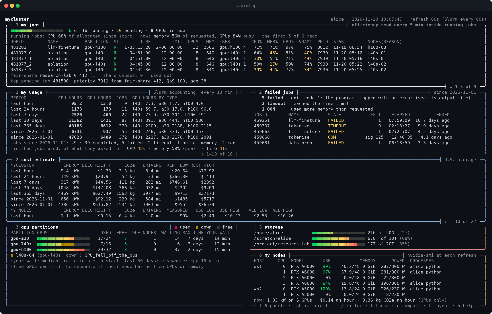

# slurmtop

A single-file Bash dashboard for your Slurm jobs, how efficiently they run, their priority
and queue wait, your usage and what it costs, how busy the GPU partitions are, your storage,
and your own GPU machines, refreshed live in the terminal.



## Features

Six panels, each shown or hidden with its number key, like in `btop`:

| Key | Panel | Shown by default | What it shows |
|-----|-------|------------------|---------------|
| `1` | my jobs | yes | Your jobs, including job arrays: state, run time, time limit, CPUs, memory, GPUs, priority, expected start, and the nodes or the reason a job is waiting. For each running job, its CPU use since it started, and its memory, GPU, and GPU memory (VRAM) use now, against what it was given. The fair-share of your accounts, and what the priority of your top pending job is made of |
| `2` | my usage | yes | CPU-hours, GPU-hours (also by GPU type) and jobs for the last hour, 24 hours, 7, 30, and 365 days, this month, and this year; this month's jobs by final state; how much of the allocated CPU time, the requested memory, and the time limit your finished jobs used, with the latest finished jobs listed (like `seff`); this month's failed jobs grouped by cause (exit code, signal, time limit, memory, node failure), with the latest ones; and a cost estimate, with what renting the same from a cloud would cost (see below) |
| `3` | GPU partitions | yes | GPUs used, down, and free, idle nodes, how many jobs are waiting (other users' jobs appear only as counts), the time limit, the median time your jobs waited to start there in the last 30 days, and why nodes are down or draining |
| `4` | limits | no | Limits of your accounts, and the time and size limits of the QoS they may use |
| `5` | storage | yes | Space used on the paths you choose |
| `6` | my nodes | yes, when set | Your own GPU machines (`SLURMTOP_MYNODES`): each GPU's use, memory, measured power, and processes, and the power they draw now |

When the window is too narrow for the whole jobs table, its least needed columns (expected
start, time limit, partition, and so on) are left out.

Also:

- A warning line when a maintenance reservation is under way or starts within 14 days
- A daily log: one line of usage a day, for your own records
- Themes (`t`): default, nord, gruvbox, light (for light terminal backgrounds), and mono
- Compact mode (`c`): panels without frames and with fewer rows
- Layout (`l`): two columns in wide windows and one in narrow or vertical ones, or a fixed
  choice of one or two columns
- Panels fit the window height; a panel whose rows do not all fit scrolls with the keys or
  the mouse wheel, keeping its table header in place
- Filters for your jobs (running or pending) and your finished jobs (completed, failed, or
  cancelled), and a text filter on job ID, name, partition, or node
- Slurm is asked in the background, so keys and scrolling keep working during a refresh
- Runs on a cluster login node, or on your own computer over ssh, reusing one connection
- Light on the cluster (see below)
- Redraws in place without flicker; rounded panels and gradient meters in 256-color
  terminals, with fallbacks for basic and non-UTF-8 terminals

## Requirements

- On the machine that runs it: Bash 4+, `awk`, `tput`, and `ssh` when Slurm runs elsewhere
- On the cluster: the Slurm commands `squeue`, `sprio`, `sshare`, `scontrol`, `sinfo`,
  `sacct`, and `sacctmgr`, plus `awk`, `df`, GNU `date`, and `timeout`. The usage and
  limits panels, and your wait in the GPU partitions panel, need Slurm accounting
  (`slurmdbd`); without it they say so and the rest works as before
- For running-job efficiency: `srun` with `--overlap` (Slurm 20.11 or later), cgroup v2 on
  the compute nodes, and `nvidia-smi` for GPU figures
- For use over ssh: a login that needs no password prompt (an ssh key or agent)
- For your own GPU machines: Linux, `nvidia-smi`, and `python3` (to read the GPUs' energy
  counters) on each, and the same kind of ssh login

## Install

```sh
curl -fsSLo slurmtop https://raw.githubusercontent.com/the-farshad/slurmtop/main/slurmtop
chmod +x slurmtop
./slurmtop
```

Or clone the repo and place the script on your `PATH`:

```sh
git clone https://github.com/the-farshad/slurmtop.git
cp slurmtop/slurmtop ~/.local/bin/
```

## Usage

```sh
slurmtop              # live view, refreshed every minute
slurmtop 30s          # refresh every 30 seconds
slurmtop 5m           # refresh every 5 minutes
slurmtop --once       # print one screen and exit
slurmtop --log        # log your own machines' energy, add the daily log line if due, and exit
slurmtop -h           # show help
```

The interval can be 1 second to 1 hour, written as `30`, `30s`, `5m`, or `1h`. Shorter
intervals redraw more often, but Slurm itself is never asked more than once every
30 seconds.

### Keys

| Key | Action |
|-----|--------|
| `1`–`6` | Show or hide a panel |
| `t` | Next theme |
| `c` | Compact mode on or off |
| `l` | Layout: auto, one column, or two columns |
| `Tab`, `Shift+Tab` | Select the next or previous panel (its frame is highlighted) |
| `↑` `↓`, `PgUp` `PgDn`, `Home` `End` | Scroll the selected panel |
| Mouse wheel, click | Scroll the panel under the pointer; select it |
| `f` | Filter by state: running or pending jobs; in my usage, completed, failed, or cancelled jobs |
| `/` | Filter by text in the job ID, name, partition, or node, applied as you type (`Enter` keeps it, `Esc` clears it) |
| `h` or `?` | Help: the keys, the panels and which are shown, and the file locations |
| `r` | Refresh now |
| `q` | Quit |

In the auto layout, panels are placed in two columns when the window is at least
181 columns wide. Each panel goes into whichever column is shorter, and the last panel of
the shorter column is stretched so both columns end on the same line. Panel 1 keeps the
full width for its table. Panel 2 comes as three cards, usage, failed jobs, and cost
estimate, so they can sit side by side; a card takes the full width only when a column is too
narrow for its tables, which can happen when two columns are chosen in a narrow window.
Narrower or vertical windows get one column, with the cards one below the other.

The panels always fit the window height. When they do not all fit, the tallest panels give
up rows first, down to their table header and three rows. A panel that is cut shows which
rows are visible (`↑↓ 13–24 of 40`) in its bottom frame, and its rows scroll while the
table header stays in place, as in `btop`.

Filters work on the job list of the selected panel: the finished jobs when my usage (or its
failed-jobs card) is selected, and your jobs otherwise. The panel title shows the filters in
use, such as `1 my jobs · running · "gpu-h100"`. A filtered list of finished jobs has all the
jobs of the month that match, including those that ended before they started.

Your panel, theme, compact, and layout choices are saved in
`~/.config/slurmtop/settings` (or `$XDG_CONFIG_HOME/slurmtop/settings`) and used the next
time.

### From your own computer

When Slurm is not installed locally, point `SLURMTOP_HOST` at a login node, either a host
name or a `Host` alias from `~/.ssh/config`:

```sh
SLURMTOP_HOST=login.mycluster.example slurmtop
```

The ssh connection is opened once and kept for 15 minutes, so later refreshes are quick.

### Cost estimate

The cost card of panel 2 estimates, for each period of my usage, the energy your jobs used,
what that electricity cost, its emissions (CO2e), the same emissions as miles driven, and what
renting the same GPUs and CPU cores from a cloud would cost, from the lowest to the highest
price found. The values are set at the top of the script (`COST_...`) to U.S. averages and
cloud list prices in dollars; change them for your site. They come from:

| Value | Used | Source |
|-------|------|--------|
| Rated power | CPU core 6.04 W; A30 165 W, L40S 350 W, H100 SXM 700 W, RTX A6000 300 W, T4 70 W | [AMD EPYC 9454](https://www.amd.com/en/products/processors/server/epyc/4th-generation-9004-and-8004-series/amd-epyc-9454.html) (290 W, 48 cores); NVIDIA data sheets for [A30](https://www.nvidia.com/en-us/data-center/products/a30-gpu/), [L40S](https://www.nvidia.com/en-us/data-center/l40s/), [H100](https://www.nvidia.com/en-us/data-center/h100/), [RTX A6000](https://www.nvidia.com/en-us/products/workstations/rtx-a6000/), [T4](https://www.nvidia.com/en-us/data-center/tesla-t4/) |
| Data-center overhead (PUE) | 1.52 | [Uptime Institute Global Data Center Survey 2026](https://datacenter.uptimeinstitute.com/rs/711-RIA-145/images/UptimeInstitute.GlobalDataCenterSurvey.2026.pdf), industry average |
| Electricity price | 14.04 cents/kWh | [EIA Electric Power Monthly, table 5.6.B](https://www.eia.gov/electricity/monthly/epm_table_grapher.php?t=epmt_5_06_b), U.S. commercial average, January to August 2026 |
| Emission rate | 349.67 kg CO2e/MWh | [EPA eGRID2023](https://www.epa.gov/egrid/summary-data) (revision 2), U.S. total output emission rate, 770.884 lb/MWh |
| Driving | 393 g CO2e/mile | [EPA Greenhouse Gas Equivalencies Calculator](https://www.epa.gov/energy/greenhouse-gas-equivalencies-calculator-calculations-and-references), average gasoline passenger vehicle |
| Cloud rental prices | the lowest and the highest on-demand price found (RENT LOW, RENT HIGH) | twelve providers' own price pages (see below) |

For a closer estimate, set the price of your state (the same EIA table) and the emission rate
of your grid region (EPA's [Power Profiler](https://www.epa.gov/egrid/power-profiler) finds it
by ZIP code). Set `COST_RATES` to your cluster's prices per core-hour and per GPU-hour of each
GPU type, to add what the compute time costs there, a column for each price list:

```sh
COST_RATES="INTERNAL: cpu=0.004 a100=0.20; EXTERNAL: cpu=0.01 a100=0.60"
```

`COST_RENT_LOW` and `COST_RENT_HIGH` have the lowest and highest cloud prices, as
`cpu=PRICE TYPE=PRICE ...`. Add the GPU types of your cluster that are missing, by their Slurm
name (`gres/gpu:TYPE`), and your own machines' GPU models (see below).

#### Cloud rental prices

On-demand list prices on each provider's own price page, November 20, 2026, in dollars per
GPU-hour: data-center offers, at the provider's cheapest configuration, per GPU. A GPU comes
with CPU cores and memory, which the price includes.

| GPU | Lowest | Highest | Also listed |
|-----|--------|---------|-------------|
| H100 SXM | $3.14 Massed Compute | $12.29 Azure (`ND96isr_H100_v5`, 8 GPUs) | Hyperstack $3.20, Jarvislabs $3.49, RunPod $4.39, Lambda $4.59, Paperspace $5.95, CoreWeave $6.155, AWS $6.88, Oracle $10.00, Google Cloud $11.06 |
| L40S | $0.97 Massed Compute | $3.50 Oracle | RunPod $1.09, E2E Networks $1.20, AWS $1.861, CoreWeave $2.25 |
| A30 | $0.35 Massed Compute | $1.35 E2E Networks | Jarvislabs $0.41 |
| RTX A6000 | $0.50 Hyperstack | $1.89 Paperspace | Massed Compute $0.55, RunPod $0.69, Lambda $1.09 |
| RTX A5000 | $0.27 RunPod | $1.38 Paperspace | Massed Compute $0.44 |
| T4 | $0.45 E2E Networks | $0.526 AWS, Azure | |
| CPU core-hour | $0.034 Oracle (E5, an OCPU with 2 GB) | $0.075 Google Cloud (`c3d-highcpu-4`, 2 cores) | AWS $0.05132 (`c7a.medium`), Azure $0.0605 (`F2als_v6`) |

A CPU core is a physical core of a 4th-generation AMD EPYC, the generation of the 9454: one
vCPU on AWS [C7a](https://aws.amazon.com/ec2/instance-types/c7a/) and Azure
[Falsv6](https://learn.microsoft.com/en-us/azure/virtual-machines/sizes/compute-optimized/fasv6-series),
two on Google Cloud C3D, and one Oracle OCPU. Community and marketplace hosts, spot instances,
and reservations cost less.

Sources: [AWS](https://aws.amazon.com/ec2/pricing/on-demand/) (US East, N. Virginia),
[Azure](https://azure.microsoft.com/en-us/pricing/details/virtual-machines/linux/) (East US),
[Google Cloud](https://cloud.google.com/products/compute/pricing/accelerator-optimized) (Iowa,
also [general-purpose](https://cloud.google.com/products/compute/pricing/general-purpose)),
[Oracle](https://www.oracle.com/cloud/price-list/), [Lambda](https://lambda.ai/pricing),
[RunPod](https://www.runpod.io/pricing) (Secure Cloud), [CoreWeave](https://www.coreweave.com/pricing),
[Massed Compute](https://massedcompute.com/pricing/), [Jarvislabs](https://jarvislabs.ai/pricing),
[Paperspace](https://www.paperspace.com/pricing), [Hyperstack](https://www.hyperstack.cloud/gpu-pricing),
and [E2E Networks](https://www.e2enetworks.com/pricing).

How it is counted:

- Energy assumes CPU cores and GPUs draw their rated power for the time they are allocated,
  which overstates idle or lightly used GPUs; memory, disks, and networking are left out.
  The total is multiplied by the PUE for cooling and power losses in the data center.
- GPU jobs are priced per GPU-hour of each GPU type and CPU-only jobs per core-hour. GPU types
  without a rated power or a price are named below the table and left out of that figure.
- Your own machines are counted as they were measured (see below), without PUE. The MEASURED
  column shows how much of the period was measured.

### Your own GPU machines

Set `SLURMTOP_MYNODES` to the ssh host names of your own GPU machines, and this machine by its
name (`hostname -s`); they are read at each refresh, at the same time and in the background:

```sh
export SLURMTOP_MYNODES="gpu1 gpu2 $(hostname -s)"
```

The energy they use is logged in `~/.local/state/slurmtop/power.tsv`, in spans of about an
hour, for the cost card, as `START END HOST GPU-JOULES CPU-JOULES GPU-TIME` (times in epoch
seconds; `GPU-TIME` is `MODEL:SECONDS:IN-USE` for each GPU model, in GPU-seconds):

- GPUs: the energy counters that the NVIDIA driver keeps for each GPU from the time the machine
  started (read through NVML). Two readings give the energy used between them exactly, however
  far apart they are, and the first reading after a machine started also covers the time
  since then. Only the energy between the last reading and a restart is lost. GPUs without
  these counters count the power `nvidia-smi` reads, for the time since the last reading when
  that is under two refreshes.
- CPUs: their rated power (TDP) times how busy they were between two readings (from
  `/proc/stat`), as in [Green Algorithms](https://doi.org/10.1002/advs.202100707) (Lannelongue
  et al., Advanced Science, 2021). Set `COST_CPUS` to the rated power of your CPUs by model
  number, such as `COST_CPUS="9454=290"`; a machine whose CPU is not listed counts its GPUs
  only. This leaves out the power an idle CPU still draws, so it is low for machines that are
  mostly idle; measuring the CPUs directly needs root.
- Memory, disks, fans, and power-supply losses are not counted.
- Renting: at the lowest and highest cloud price of their GPU models (found by a word of the
  model name, such as `a6000` in `NVIDIA RTX A6000`), USE for the time a process was on the
  GPU, and ALL for every GPU for all the time measured, which is what renting the same machines
  full time would cost. A GPU is in use from when the oldest process on it at a
  reading started, so a process that starts and ends between two readings is missed, and the
  first reading after a machine started finds only the processes running then.

Every slurmtop that runs adds its readings, and `slurmtop --log` from cron adds one each time
it runs, so the log keeps going when no slurmtop is open; each reading counts from the last
one, whichever slurmtop took it. Every hour is enough:

```
0 * * * * SLURMTOP_MYNODES="gpu1 gpu2 mymachine" /path/to/slurmtop --log
```

### Daily log

Whenever slurmtop reads Slurm accounting and the last log line is 23 hours old or more, it
adds a line to `~/.local/state/slurmtop/daily.tsv` (or `$XDG_STATE_HOME/slurmtop/daily.tsv`).
The file is tab-separated with a header row, so it opens in a spreadsheet. Each line covers
the 24 hours before its time: CPU-hours, GPU-hours (also by GPU type), jobs that ran, jobs
that ended by state, how much of the allocated CPU time, requested memory, and time limit
those jobs used, and your fair-share and storage at that time.

Lines are written only while slurmtop runs. To log every day without it, run
`slurmtop --log` from cron, for example at 23:50; it asks Slurm only when a line is due, so
it can also run every hour (as above):

```
50 23 * * * SLURMTOP_HOST=mycluster /path/to/slurmtop --log
```

## Light on the cluster

- Slurm is asked at most every 30 seconds, whatever the refresh interval; `r` and newly
  shown panels ask at most every 5 seconds
- Accounting, storage, maintenance reservations, limits, and the partition list are asked
  every 10 minutes, and the cluster name only at the start
- Hidden panels are not asked for: hiding panel 1 skips `sprio`, `sshare`, and the
  running-job efficiency steps, hiding panel 3 skips the node, pending-job, and partition
  queries, and hiding panel 4 skips `sacctmgr`
- All commands run on the login node at low priority (`nice`)
- Running-job efficiency is read every 5 minutes, and only while panel 1 is shown. For
  each running job (at most 16, 8 at a time) it starts a short step with
  `srun --overlap` that reads the job's cgroup counters and runs `nvidia-smi`, which takes
  well under a second. These steps appear in `sacct` as extra steps of your jobs.

## Configuration

All settings are environment variables:

| Variable              | Default                                     | Description                                                     |
|-----------------------|---------------------------------------------|-----------------------------------------------------------------|
| `SLURMTOP_HOST`       | none (Slurm on this machine)                | ssh host to run the Slurm commands on                           |
| `SLURMTOP_PARTITIONS` | GPU partitions your accounts and groups may use | Space-separated GPU partitions to show                       |
| `SLURMTOP_ACCOUNT`    | all of your accounts                        | Account to show the fair-share of                               |
| `SLURMTOP_PATHS`      | `~`                                         | Space-separated paths on the cluster to show storage for; `~` and `$USER` are expanded on the cluster |
| `SLURMTOP_MYNODES`    | none                                        | Your own GPU machines for panel 6: ssh host names, and this machine by its name |

Example, for a shell startup file:

```sh
export SLURMTOP_HOST=mycluster
export SLURMTOP_PARTITIONS="gpu-a100 gpu-h100"
export SLURMTOP_PATHS='~ /scratch/$USER'
```

## Notes

- GPU counts come from each node's configured and allocated GPUs (`gres/gpu`). A free GPU
  can still be unusable when its node has no free CPUs or memory.
- "WAITING" counts every user's pending jobs that may run in the partition; a job
  submitted to several partitions counts in each of them.
- The reasons for down nodes are the ones the administrators gave, without the name of the
  person who set them.
- "YOUR WAIT" runs from when a job became eligible to start (submitted, and any dependency
  met) to when it started, so time spent waiting on your own dependencies or holds is left
  out. For job arrays, a task counts from when the array became eligible. Waits in
  partitions that are not shown are listed below the table.
- The priority breakdown comes from `sprio`, which leaves out jobs that are not eligible to
  start yet, such as jobs waiting on a dependency.
- Usage counts only the part of each job's run inside the period, and running jobs up to
  now. It is based on what jobs were allocated, not on how busy their CPUs or GPUs were.
- Efficiency of finished jobs compares what they used with what they asked for: CPU time
  with elapsed time × CPUs, peak memory (`MaxRSS`) with requested memory, and run time with
  the time limit. Values below 50% are highlighted. GPU utilization is not included.
- Running-job efficiency fills that gap for jobs that are still running: CPU time since the
  job started (from its cgroup), memory in use now (the cgroup's anonymous memory, without
  file cache), and GPU utilization and memory now (from `nvidia-smi`). For a job on several
  nodes, only its first node is read.
- Storage shows what `df` reports for each path: the size of the file system, or your
  quota on file systems that report quotas as their size.

## License

GNU General Public License v3.0 — see [LICENSE](LICENSE).
